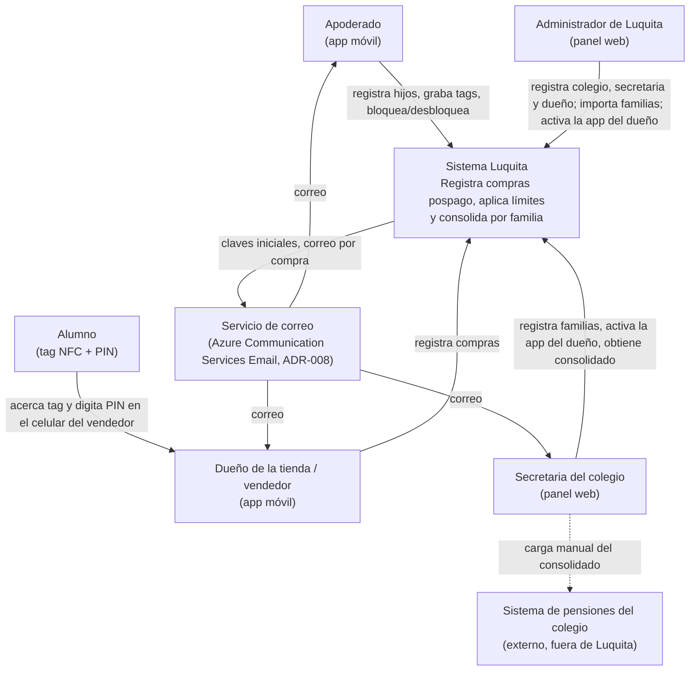
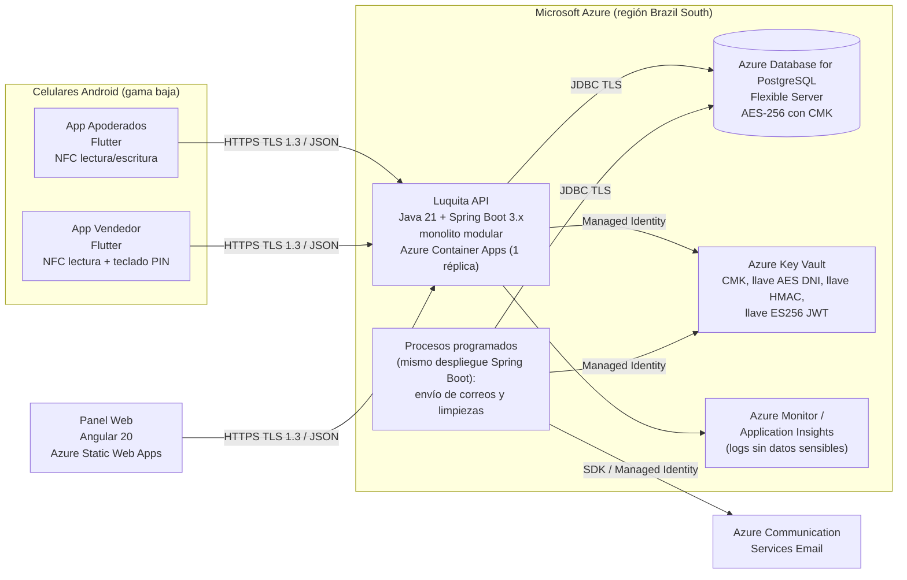

# 07 — Arquitectura de LUQUITA

- **Producto:** Luquita, billetera digital infantil con tag NFC para la tienda del colegio (pospago, en convenio con el colegio).
- **País de operación:** Perú. **Piloto:** colegio particular en Lurigancho-Chosica, Lima (~200 alumnos de 8 a 14 años).
- **Fase:** planificación. Agente Architect (BMAD).
- **Documentos base:** `00-constitucion.md` v1.17, `06-user-stories-refinadas.md` (2026-11-11), `02-alcance.md` y `01-project-brief.md` (secciones 2, 6 y 7), verificados en la v0.3.
- **Alcance:** MVP (funcionalidades Must M1 a M5: HU-001 a HU-018 y HU-033).
- **Fecha:** 2026-11-11. **Versión:** 0.5.3 (borrador; la v0.5.2 y las anteriores fueron aprobadas el 2026-11-13 por David Yallerco).

### Historial de cambios

| Versión | Fecha | Cambio |
|---|---|---|
| 0.1 | 2026-11-11 | Borrador sin constitución ni HUs (descartado). |
| 0.2 | 2026-11-11 | Reescritura completa alineada a la constitución 1.15 y a las 20 HU Must. Se eliminan el cobro sin conexión, los tags NTAG 424, Kotlin, las notificaciones push, el catálogo de productos y los datos del alumno no permitidos. |
| 0.3 | 2026-11-11 | Revisión contra `02-alcance.md` y `01-project-brief.md`. Identificadores en español (`/autenticacion`, `tokenAcceso`, `tokenRenovacion`, `idTraza`). Nuevos contratos: renovación de sesión, listas de colegios, usuarios, familias e hijos con sus tags, y fin del año escolar. Se marcan todas las dependencias que requieren aprobación humana. Purga del cuerpo de los correos, orden fijo de bloqueos y supuesto de internet en la tienda. |
| 0.3.1 | 2026-11-11 | El equipo confirma la vigencia del token de renovación y la búsqueda de familias por DNI en la URL. |
| 0.3.2 | 2026-11-11 | Decisiones del equipo tras el backlog: columna `movimiento.codigo_compra`, tabla `token_renovacion`, primer periodo en marzo (el Excel se sube en febrero) con periodos todos los meses desde ahí, inicio de sesión del administrador con correo y clave, y una sola réplica del backend. Se retiran los trámites legales (piloto académico). |
| 0.4 | 2026-11-11 | Decisiones del equipo tras la auditoría `09` (constitución 1.16): temporada de ventas de marzo a noviembre con habilitación por la secretaria o el administrador (nueva sección 4.3.6, ADR-010, columna `colegio.ventas_habilitadas` y código `VENTAS_NO_HABILITADAS`, que reemplaza a `SIN_PERIODO_ABIERTO`); el primer periodo nace con la primera habilitación y no hay periodos de diciembre a febrero; DNI duplicado dentro del Excel (RN-098). Se retiran el Libro de Reclamaciones (HU-019, HU-020, ADR-009, `codigo_compra`) y el detalle de protección de datos (consentimiento y retención de 5 años). |
| 0.4.1 | 2026-11-11 | Auditoría M-01: la idempotencia de `POST /compras` guarda el resultado de cada intento, también los rechazos (en `operacion_idempotente`), y el reintento lo devuelve sin volver a verificar el PIN. `hash_solicitud` pasa a HMAC-SHA256. Nuevo estado `RECHAZADA` en la verificación de un cobro (§4.5.3). |
| 0.5 | 2026-11-13 | Simplificación del piloto (constitución 1.17): sin suscripción; sin tabla `periodo`, sin cierre mensual programado (C5 retirado) ni consolidado materializado: el consolidado se calcula al consultarlo (ADR-005 reescrito); sin temporada ni fin del año escolar (4.3.4b y HU-025 retirados); la app del dueño activa es un interruptor sin fechas (ADR-010 y 4.3.6 simplificados; `FUERA_DE_TEMPORADA`, `PERIODO_CERRADO` y `PERIODO_ABIERTO` retirados); el Excel lo importan la secretaria o el administrador, sin columna `estado`; la secretaria cambia el estado de una familia; PIN del alumno de 3 dígitos. |
| 0.5.1 | 2026-11-13 | Cierre de hallazgos de la auditoría `09`: códigos ✱ confirmados; política de clave nueva (RN-105); token de renovación del panel en cookie `HttpOnly`; `TAG_YA_ACTIVO`; solo Android en el piloto; procedimientos operativos (§6.7); correcciones de formato. |
| 0.5.2 | 2026-11-13 | David Yallerco aprueba los ADR vigentes (ADR-001 a ADR-008 y ADR-010), la lógica de activación de la app del dueño y la lista de dependencias de la sección 6.1 (T-001 y T-002). Se elige ArchUnit para las fronteras entre módulos. |
| 0.5.3 | 2026-11-14 | Resueltas Q-01 a Q-04 de `09-ui-spec.md` (validación de la UI): nuevo `GET /admin/colegios/{colegioId}/usuarios`; `GET /apoderado/alumnos` agrega `familiaActiva` y `activadoEn`. Requiere la aprobación humana de estos cambios de API (PRINCIPIO-009). |

**Convenciones:** identificadores en español ASCII (PRINCIPIO-001); montos en soles con dos decimales; horas en ISO 8601 con zona `America/Lima`; solo datos ficticios (apoderado `00000000`, secretaria `00000001`, alumno `00000010`).

> **Aprobación humana requerida (PRINCIPIO-009).** Este documento define lógica de consumo, límites, consolidado mensual y activación de la app del dueño, y propone un proveedor de correo y una dependencia (Apache POI). Ningún agente puede implementarlos sin que un humano apruebe los ADR correspondientes. **Estado: aprobado el 2026-11-13 por David Yallerco** (ADR, lógica de negocio, proveedor de correo y dependencias).

---

## 1. Overview del sistema

### 1.1 Descripción

Luquita registra el consumo pospago de cada alumno en la tienda del colegio; no maneja dinero. El vendedor ingresa el monto en su app Flutter, el alumno acerca su tag NFC (que solo guarda un token aleatorio) y digita su PIN de 3 dígitos. El backend Spring Boot valida **en línea y en una sola transacción** que la app del dueño esté activa, el tag, el PIN, el estado de la familia y los límites diario y mensual, e inserta un `Movimiento` inmutable con la fecha del servidor. Por cada compra se envía un correo al apoderado. No hay cierre mensual: cuando la secretaria lo pide, el panel Angular calcula el consolidado del mes elegido (consumo de cada alumno por familia) para cargarlo en la boleta. La secretaria o el administrador activan y desactivan la app del dueño (ADR-010).

### 1.2 Diagrama C4 — Nivel 1: Contexto



### 1.3 Diagrama C4 — Nivel 2: Contenedores



### 1.4 Principios de diseño

| # | Principio | Implicancia concreta | Origen |
|---|---|---|---|
| D1 | **El servidor es la única autoridad** | App del dueño activa, tag, PIN, estado de la familia y límites se validan en el servidor, en la misma transacción que inserta el movimiento. Las apps solo validan formato. | PRINCIPIO-005, 006 |
| D2 | **Sin conexión no hay cobro** | La app del vendedor no guarda compras para enviarlas después. Ante una respuesta perdida, solo reintenta la misma operación con la misma `Idempotency-Key` mientras está en pantalla (ADR-002). | PRINCIPIO-005, RN-090 |
| D3 | **Ledger de solo inserción** | Un único modelo `Movimiento` (`COMPRA`, `ANULACION`, `AJUSTE`). El consumo es la suma de movimientos; nunca `UPDATE` ni `DELETE` de negocio. | PRINCIPIO-004 |
| D4 | **Idempotencia en toda escritura** | Todo `POST` de negocio exige `Idempotency-Key`. | PRINCIPIO-004 |
| D5 | **Datos mínimos de menores** | Del alumno solo DNI (cifrado) y nombre. El vendedor solo ve el nombre. El colegio solo ve el consolidado. | PRINCIPIO-007 |
| D6 | **Seguridad por defecto** | DNI cifrado con AES-256-GCM + índice ciego HMAC; PIN y claves con Argon2id; JWT ES256 de 15 min; secretos solo en Key Vault; logs sin PIN, claves, DNI, tokens ni secretos. | PRINCIPIO-008 |
| D7 | **Ligero y explícito para Perú** | Payloads pequeños, mensajes de error inequívocos (cobrado / no cobrado / sin confirmar), timeouts cortos y reintentos acotados para wifi inestable. | Contexto peruano |
| D8 | **Simplicidad para el piloto** | Un solo despliegue Spring Boot y una sola base de datos, con `colegio_id` en las entidades para crecer a varios colegios. | PRINCIPIO-002 |
| D9 | **Accesible y documentado** | WCAG 2.1 AA en Flutter y Angular; OpenAPI 3.x en `docs/api/openapi.yaml`; C4 y ADRs en el repositorio. | PRINCIPIO-011, 012 |

---

## 2. Componentes principales

| # | Componente | Responsabilidad | Tecnología | HUs |
|---|---|---|---|---|
| C1 | **App Apoderados** | Crear cuenta e iniciar sesión (DNI + PIN de 6 dígitos); registrar hijos con su PIN de 3 dígitos; validar el chip, grabar el token NDEF, verificarlo y bloquearlo contra escritura (lock bits); bloquear y desbloquear tags. | Flutter 3.x (Android 8+; iOS fuera del piloto); paquete NFC con soporte NDEF y lock en NTAG21x (dependencia sujeta a aprobación humana); `flutter_secure_storage` para el token de renovación; montos como enteros en céntimos. | HU-006, HU-007, HU-008, HU-009, HU-010, HU-016, HU-017 |
| C2 | **App Vendedor** | Inicio de sesión con correo + clave y cambio obligatorio de la clave inicial; pantalla de cobro (monto, descripción ≤ 60 caracteres, lectura del tag, teclado de PIN de 3 dígitos enmascarado de 48×48 dp); muestra solo el nombre del alumno; estados "Cobrado", "Rechazado (motivo)", "Sin conexión" y "No se pudo confirmar el cobro"; aviso "La app de cobro no está activa. Consulta con la secretaría del colegio." sin acceso al cobro (RN-103). | Flutter 3.x (Android 8+ con NFC). Sin base de datos local de compras. | HU-011, HU-012, HU-013, HU-014, HU-033 |
| C3 | **Panel Web** | Administrador: iniciar sesión con correo y clave, registrar colegios, secretarias y dueños de tienda, importar el Excel de familias de un colegio y activar o desactivar la app del dueño. Secretaria: iniciar sesión con DNI y cambiar la clave inicial, importar el Excel de familias, buscar, registrar o corregir familias (incluido su estado), activar o desactivar la app del dueño y obtener el consolidado de un mes. | Angular 20, Azure Static Web Apps, `aria-label` en todos los controles. | HU-001, HU-002, HU-003, HU-004, HU-005, HU-018, HU-033 |
| C4 | **Luquita API** (monolito modular) | Fuente de verdad. Módulos: `autenticacion`, `administracion`, `familias`, `alumnos`, `tags`, `compras` (ledger, límites, idempotencia), `consolidado` (activación de la app del dueño y consolidado mensual), `notificaciones` (outbox), `criptografia`. | Java 21, Spring Boot 3.x (Web, Security, Data JPA, Validation), Flyway (migraciones ejecutadas solo por humanos), Spring Modulith o ArchUnit para fronteras entre módulos (dependencia sujeta a aprobación), Azure Container Apps con una sola réplica (ADR-006). | HU-001 a HU-018, HU-033 |
| ~~C5~~ | ~~**Proceso de cierre mensual**~~ | Retirado el 2026-11-13: el consolidado se calcula al consultarlo (ADR-005). | — | — |
| C6 | **Servicio de correo** (outbox) | Envía la clave inicial y el correo por compra (fecha, hora, tienda, monto, consumo del mes). 1 intento + 3 reintentos cada 60 s, con registro de cada intento. Asíncrono: nunca forma parte de la transacción de compra. | Tabla `correo_saliente` + `@Scheduled` cada 10 s en C4 + Azure Communication Services Email (ADR-008). | HU-002, HU-015 |
| C7 | **Base de datos** | Persistencia transaccional; ledger `movimiento` de solo inserción garantizado por permisos y trigger; cifrado en reposo. | Azure Database for PostgreSQL Flexible Server 16, AES-256 con llave administrada por el cliente en Key Vault. | HU-012, HU-013, HU-018 (y todas) |
| C8 | **Gestión de secretos y llaves** | Llave AES-256 para DNI, llave HMAC-SHA256 para índices ciegos y tokens de tag, llave ES256 para firmar JWT, credenciales de ACS y CMK de PostgreSQL. | Azure Key Vault + Managed Identity. | HU-002, HU-003, HU-006, HU-007, HU-008, HU-011 |

### 2.1 Flujo crítico: cobro con tag y PIN (HU-012, HU-013, HU-014)

```
App Vendedor                                  Luquita API (una transacción)
-----------                                   ---------------------------------------------
1. Ingresa monto "3.50" y descripción.
2. Genera Idempotency-Key (UUID v4) y la
   guarda SOLO en memoria de la pantalla.
3. Alumno acerca el tag → lee NDEF
   "luquita:tag:<uuid>".
4. POST /tags/resolucion → muestra
   "Alumno Prueba" (solo el nombre).
5. Alumno digita PIN (•••).
6. POST /compras  ───────────────────────────► a. JWT válido, rol DUENO_TIENDA, clave ya cambiada.
   (timeout 8 s)                               b. Idempotency-Key presente; si ya hay un resultado
                                                  guardado para (vendedor, clave): mismo contenido →
                                                  devuelve ese resultado (cobro O rechazo) sin
                                                  ejecutar nada más; otro contenido → 409
                                                  IDEMPOTENCY_KEY_REUTILIZADA (RN-015, M-01).
                                               c. Valida monto (>0, 2 decimales) y descripción (≤60).
                                               c2. App del dueño no activa (ventas_habilitadas = false)
                                                  → 409 VENTAS_NO_HABILITADAS (sin leer el
                                                  tag ni verificar el PIN; RN-097).
                                               d. Resuelve el tag por HMAC del token (sin caché).
                                               e. SELECT ... FOR UPDATE del tag y LUEGO del alumno
                                                  (siempre en ese orden, para evitar deadlocks).
                                               f. Tag BLOQUEADO → 422 TAG_BLOQUEADO.
                                               g. Verifica PIN (Argon2id). Fallo → intentos+1;
                                                  al 3.º fallo, tag BLOQUEADO (motivo PIN_FALLIDO);
                                                  COMMIT del contador junto con el resultado
                                                  guardado → 401 PIN_INVALIDO.
                                                  Acierto → intentos = 0.
                                               h. Familia INACTIVO → 422 FAMILIA_INACTIVA.
                                               i. (Retirado en v0.5: ya no hay periodos que cerrar;
                                                  registrado_en y fecha_lima los fija el servidor.)
                                               j. Consumo del día + monto > 30.00 → 422 LIMITE_DIARIO_EXCEDIDO.
                                               k. Consumo del mes + monto > tope (≤300.00)
                                                  → 422 LIMITE_MENSUAL_EXCEDIDO.
                                               l. INSERT movimiento COMPRA +3.50 e INSERT correo_saliente.
                                               m. INSERT del resultado en operacion_idempotente
                                                  y COMMIT → 201. Todo rechazo de los pasos c2 a k
                                                  también guarda su resultado en la misma
                                                  transacción antes de responder.
7. 201 → "Cobrado". 4xx → motivo.
   Timeout o corte → "No se pudo confirmar
   el cobro" + botón "Verificar" (ADR-002).
```

**Resultado de cada intento (auditoría M-01).** Una `Idempotency-Key` identifica un intento de cobro. El servidor guarda el resultado de todo lo que confirmó: `201`, `401 PIN_INVALIDO`, los `422` (límites, tag bloqueado, suscripción inactiva), `409 VENTAS_NO_HABILITADAS` y los `400` de formato. No guarda nada si la transacción no llegó a confirmarse (`503`, error interno, timeout sin commit): ese reintento se procesa de nuevo, porque no quedó ningún efecto. Si dos solicitudes con la misma clave llegan a la vez, la segunda falla al insertar su resultado (restricción única), hace rollback completo, incluido el contador de PIN, y devuelve el resultado de la primera. Cuando el alumno vuelve a digitar el PIN, la app usa una clave nueva.

---

## 3. Modelo de datos

### 3.1 Convenciones

- PK `id` UUID (v4) salvo que se indique otra cosa. Tablas y columnas en `snake_case` ASCII.
- Montos: `NUMERIC(12,2)` en PostgreSQL y `BigDecimal` escala 2 con `RoundingMode.HALF_EVEN` en Java.
- Fechas: `timestamptz`; `registrado_en` y `fecha_lima` (`date`) los fija el servidor con `America/Lima` al insertar; nunca se aceptan del cliente (RN-034).
- `colegio_id` en todas las entidades de negocio. El colegio del usuario se toma del JWT y nunca del request.

### 3.2 Entidades

| Entidad (tabla) | Atributos clave | Notas de seguridad / reglas |
|---|---|---|
| **Colegio** (`colegio`) | `id`, `nombre` (con tildes, sin alterar), `creado_en`, `ventas_habilitadas` `boolean` default `false` (app del dueño activa), `ventas_cambiadas_en`, `ventas_cambiadas_por` | Unicidad del nombre por confirmar (HU-001). Solo la secretaria del colegio o el administrador cambian `ventas_habilitadas`, en cualquier fecha (ADR-010). |
| **Tienda** (`tienda`) | `id`, `colegio_id`, `nombre` ("Tienda del colegio") | Aparece en el correo de cada compra. |
| **Usuario del personal** (`usuario_personal`) | `id`, `colegio_id` (nulo para admin), `rol` (`ADMIN_LUQUITA`, `SECRETARIA`, `DUENO_TIENDA`), `dni_cifrado` `bytea`, `dni_nonce` `bytea(12)`, `dni_hmac` `bytea` (único, solo secretaria), `correo` (único, minúsculas), `clave_hash` (`$argon2id$…`), `debe_cambiar_clave` `boolean`, `intentos_fallidos`, `bloqueado_hasta` | La secretaria entra con DNI; el dueño y el administrador, con correo. Clave aleatoria de 12 caracteres. Bloqueo de 15 min al 5.º fallo. El primer administrador lo crea un humano con un script de arranque. |
| **Año escolar** (`anio_escolar`) | `id`, `colegio_id`, `anio` | Se crea al registrar la primera familia del año (importación o registro manual). `anio` es el año calendario de ese registro: el Excel se sube en febrero y el año escolar empieza en marzo. |
| **Familia** (`familia`) | `id`, `colegio_id`, `apoderado_dni_cifrado`, `apoderado_dni_nonce`, `apoderado_dni_hmac` (único por colegio), `apoderado_nombre`, `apoderado_apellidos`, `apoderado_correo`, `estado` (`ACTIVO`/`INACTIVO`) | Se identifica por el DNI del apoderado. Toda familia importada o registrada queda `ACTIVO`; solo la secretaria cambia el correo y el estado (RN-104). |
| **Suscripción anual** (`familia_anio`) | `familia_id`, `anio_escolar_id`, `registrada_desde` (date) | Una fila por año escolar en que la familia fue registrada (reimportación de HU-004). |
| **Cuenta del apoderado** (`cuenta_apoderado`) | `id`, `familia_id` (único: un apoderado por familia), `pin_hash` (Argon2id, 6 dígitos), `intentos_fallidos`, `bloqueado_hasta`, `creada_en` | Solo si la familia está `ACTIVO` al crearla. |
| **Alumno** (`alumno`) | `id`, `familia_id`, `colegio_id`, `nombre`, `dni_cifrado`, `dni_nonce`, `dni_hmac`, `pin_hash` (Argon2id, 3 dígitos), `tope_mensual` `NUMERIC(12,2)` default `300.00`, check `0.00..300.00` | **Datos de menor: solo DNI y nombre.** Prohibido guardar grado, foto, fecha de nacimiento o alergias. Unicidad de `dni_hmac` por confirmar (HU-008). |
| **Tag** (`tag`) | `id`, `alumno_id`, `token_hmac` `bytea` (único), `token_prefijo` (4 caracteres, solo para logs), `tipo_chip` (`NTAG213`/`NTAG215`), `estado` (`RESERVADO`, `ACTIVO`, `BLOQUEADO`), `motivo_bloqueo` (`MANUAL`, `PIN_FALLIDO`), `intentos_pin_fallidos`, `reservado_en`, `activado_en`, `bloqueado_en` | El token (UUID v4) no se guarda en claro, solo su HMAC (ADR-007). El estado del tag nunca se guarda en caché. |
| **Movimiento** (`movimiento`) | `id`, `colegio_id`, `alumno_id`, `tienda_id`, `tipo` (`COMPRA`, `ANULACION`, `AJUSTE`), `monto` `NUMERIC(12,2)` con signo, `descripcion` `varchar(60)` nula, `registrado_en` `timestamptz`, `fecha_lima` `date`, `movimiento_origen_id` (para `ANULACION`), `idempotency_key` `uuid`, `registrado_por` (usuario) | **Solo inserción.** Único (`registrado_por`, `idempotency_key`), como segunda barrera contra el doble cobro; el resultado del intento vive en `operacion_idempotente`. En el MVP solo se insertan `COMPRA` (S1 fuera de alcance). Los `AJUSTE` no cuentan para los límites. |
| ~~Periodo y consolidados materializados~~ | — | Retirados el 2026-11-13 (`periodo`, `consolidado`, `consolidado_familia`, `consolidado_alumno`): el consolidado se calcula al consultarlo (ADR-005). |
| **Correo saliente** (`correo_saliente`) | `id`, `tipo` (`CLAVE_INICIAL`, `COMPRA`), `destinatario`, `asunto`, `cuerpo`, `estado` (`PENDIENTE`, `ENVIADO`, `FALLIDO`), `proximo_intento_en`, `creado_en` | Outbox. El cuerpo de la compra se arma al insertar (mes y consumo de la compra, aunque el reintento ocurra en el mes siguiente). El cuerpo de `CLAVE_INICIAL` se borra al enviarse. El cuerpo de `COMPRA` (incluye nombre del alumno y montos) se borra 30 días después del envío o del último intento; quedan solo los metadatos y los intentos (no es ledger: no aplica la inmutabilidad). |
| **Intento de correo** (`correo_intento`) | `correo_id`, `numero` (1 a 4), `resultado` (`ENVIADO`, `FALLIDO`), `ocurrido_en`, `detalle_error` | Sin PIN, DNI ni tokens. |
| **Operación idempotente** (`operacion_idempotente`) | `usuario_id`, `idempotency_key`, `operacion` (`COMPRA`, `REGISTRAR_ALUMNO`, `RESERVAR_TAG`, `BLOQUEAR_TAG`, …), `hash_solicitud` `bytea`, `codigo_http`, `codigo_error` (nulo si fue exitosa), `movimiento_id` (nulo salvo en una `COMPRA` registrada), `respuesta` `jsonb`, `creada_en` | Único (`usuario_id`, `idempotency_key`). Guarda el resultado de todos los `POST` de negocio, **incluidas las compras con cualquier resultado, también los rechazos** (auditoría M-01). `hash_solicitud` es `HMAC-SHA256(llave_hmac, cuerpo canónico)`: incluye el PIN para distinguir intentos, pero el PIN de 3 dígitos no se puede recuperar por fuerza bruta sin la llave. `respuesta` nunca contiene el PIN ni el token del tag. Retención de 7 días. |
| **Auditoría** (`auditoria`) | `id`, `actor_rol`, `actor_id`, `accion`, `entidad`, `entidad_id`, `ocurrido_en` | Solo inserción. Sin DNI, PIN, claves ni tokens. |
| **Token de renovación** (`token_renovacion`) | `id`, `tipo_usuario` (`APODERADO`, `PERSONAL`), `usuario_id`, `token_hash` `bytea` (único), `cadena_id` `uuid`, `reemplazado_por` (nulo hasta rotar), `emitido_en`, `vence_en`, `revocado_en` | Solo guarda el hash SHA-256 del token opaco. Cada rotación crea una fila nueva en la misma cadena; reusar un token ya rotado revoca toda la cadena (sección 4.2.4). Vigencia: 12 h para el personal y 30 días para el apoderado. Un proceso diario borra las filas vencidas hace más de 30 días. |

### 3.3 Relaciones

```
Colegio 1──N Tienda
Colegio 1──N UsuarioPersonal            (1 secretaria y 1 dueño en el piloto)
Colegio 1──N AnioEscolar
Colegio 1──N Familia 1──1 CuentaApoderado
Familia N──M AnioEscolar                (via familia_anio)
Familia 1──N Alumno 1──N Tag            (MVP sin regla de un solo tag activo: RN-010 es S3)
Colegio 1──N Movimiento N──1 Alumno
Movimiento 0..1──N Movimiento           (ANULACION → COMPRA origen, desde S1)
CorreoSaliente 1──N CorreoIntento
UsuarioPersonal / CuentaApoderado 1──N TokenRenovacion   (agrupados por cadena_id)
```

### 3.4 Notas de seguridad

1. **DNI** (apoderado, alumno, secretaria): `AES-256-GCM` con nonce de 96 bits único por registro, en columnas `bytea`. Búsqueda por `HMAC-SHA256(llave_hmac, dni)`. Las llaves viven en Key Vault y se cargan con Managed Identity.
2. **PIN y claves:** Argon2id `m=19456 KiB, t=2, p=1`. PIN del apoderado: 6 dígitos, bloqueo de 15 min al 5.º fallo. PIN del alumno: 3 dígitos, bloqueo del **tag** al 3.er fallo consecutivo, que solo el apoderado desbloquea. Claves del personal: 12 caracteres aleatorios, cambio obligatorio en el primer inicio de sesión.
3. **Token del tag:** el tag guarda `luquita:tag:<UUID v4>` (122 bits aleatorios). El servidor guarda `HMAC-SHA256(llave_hmac, token)`: aunque se filtre la base de datos, no se pueden fabricar tags válidos. En los logs solo aparece `tagId=9f1c…`.
4. **Ledger inmutable:** el rol de la aplicación tiene `INSERT, SELECT` sobre `movimiento`, nunca `UPDATE` ni `DELETE`. Un trigger rechaza `UPDATE`/`DELETE` como segunda barrera.
5. **Minimización por actor:**
   - Vendedor: solo `nombreAlumno`.
   - Colegio: solo el consolidado (nombre, DNI y total por alumno).
   - Apoderado: solo sus hijos.
6. **Prohibido:** analítica, publicidad, Firebase Analytics, Google Ads o cesión de datos a terceros. Application Insights solo recibe métricas técnicas y logs saneados (sin cuerpos de request en los endpoints de autenticación, alumnos, tags y compras).
7. **Datos de prueba:** solo ficticios, con DNI distintos por actor (`00000000`, `00000001`, `00000010`).

---

## 4. API Contracts

### 4.0 Convenciones generales

- **Base:** `https://api.luquita.pe/api/v1` (dominio por confirmar). JSON UTF-8. Especificación fuente de verdad: `docs/api/openapi.yaml` (PRINCIPIO-012).
- **Autenticación:** `Authorization: Bearer <JWT ES256>`, expiración de 15 min. Claims: `sub`, `rol` (`APODERADO`, `SECRETARIA`, `DUENO_TIENDA`, `ADMIN_LUQUITA`), `colegioId`, `cambioClavePendiente`. **El JWT nunca lleva DNI.** Para renovar se usa un token de renovación opaco y rotativo (`POST /autenticacion/renovacion`), guardado como hash. Implementación humana obligatoria (PRINCIPIO-009).
- **Idempotencia:** header `Idempotency-Key: <UUID v4>` obligatorio en todo `POST` de negocio.
  - Misma clave y mismo contenido → misma respuesta original, sin nuevo efecto, sea un éxito o un rechazo de negocio (en `POST /compras`, sin volver a verificar el PIN).
  - Misma clave y otro contenido → `409 IDEMPOTENCY_KEY_REUTILIZADA`.
  - Sin la clave → `400 IDEMPOTENCY_KEY_REQUERIDA`.
- **Montos en JSON:** string decimal con exactamente 2 decimales, por ejemplo `"monto": "3.50"`. Así ni Dart ni JavaScript los parsean como `double`, y el servidor puede rechazar `"3.505"`. Flutter los convierte a céntimos enteros y Java a `BigDecimal`.
- **Errores:** RFC 9457 (`application/problem+json`), con un campo `codigo` estable:

```json
{
  "type": "https://api.luquita.pe/errores/LIMITE_DIARIO_EXCEDIDO",
  "title": "Límite diario excedido",
  "status": 422,
  "codigo": "LIMITE_DIARIO_EXCEDIDO",
  "detail": "La compra supera el límite diario de S/ 30.00.",
  "idTraza": "4bf92f3577b34da6"
}
```

### 4.1 Catálogo de códigos de error

Los marcados con ✱ eran propuestas para cerrar el Pendiente 3 de las HU; **quedaron confirmados el 2026-11-13**.

| HTTP | `codigo` | Cuándo |
|---|---|---|
| 400 | `DATOS_INVALIDOS` | Validación genérica de formato (con `errores[]` por campo). |
| 400 | `DNI_INVALIDO` | No tiene exactamente 8 dígitos. |
| 400 | `PIN_FORMATO_INVALIDO` | PIN del apoderado ≠ 6 dígitos o del alumno ≠ 3 dígitos. |
| 400 | `MONTO_INVALIDO` ✱ | ≤ 0, negativo o con más de 2 decimales. |
| 400 | `DESCRIPCION_MUY_LARGA` ✱ | Más de 60 caracteres (se cuentan caracteres, no bytes). |
| 400 | `IDEMPOTENCY_KEY_REQUERIDA` ✱ | Falta el header. |
| 401 | `NO_AUTENTICADO` | Sin JWT o JWT vencido. |
| 401 | `CREDENCIALES_INVALIDAS` | DNI/correo o PIN/clave incorrectos. El mismo mensaje si el usuario no existe. |
| 401 | `PIN_INVALIDO` | PIN del alumno incorrecto en una compra. |
| 403 | `ACCESO_DENEGADO` | Rol o propiedad del recurso incorrectos. |
| 403 | `CAMBIO_CLAVE_PENDIENTE` ✱ | El personal no cambió la clave inicial. |
| 404 | `TAG_NO_RECONOCIDO` ✱ | El token no pertenece a ningún tag `ACTIVO` o `BLOQUEADO`. |
| 409 | `IDEMPOTENCY_KEY_REUTILIZADA` ✱ | Misma clave con otro contenido. |
| 409 | `VENTAS_NO_HABILITADAS` | Compra o resolución de tag mientras la app del dueño no está activa (RN-097). |
| 409 | `RECURSO_DUPLICADO` | Correo, colegio, familia o cuenta ya existentes. |
| 409 | `TAG_YA_GRABADO` ✱ | El tag ya tiene datos o lock bits (validación del chip). |
| 409 | `TAG_YA_ACTIVO` ✱ | Se intenta activar un tag que ya está `ACTIVO`. |
| 422 | `TAG_NO_COMPATIBLE` ✱ | Chip distinto de NTAG213/NTAG215. |
| 422 | `TAG_BLOQUEADO` ✱ | Compra con un tag bloqueado (manual o por PIN). |
| 422 | `FAMILIA_INACTIVA` | Familia `INACTIVO`. |
| 422 | `DNI_NO_REGISTRADO` | DNI que no pertenece a una familia `ACTIVO` (mismo caso si es `INACTIVO`). |
| 422 | `LIMITE_DIARIO_EXCEDIDO` | Consumo del día + monto > S/ 30.00 (se valida primero ✱). |
| 422 | `LIMITE_MENSUAL_EXCEDIDO` | Consumo del mes + monto > tope mensual. |
| 422 | `MES_FUTURO` ✱ | Se pide el consolidado de un mes que todavía no empieza. |
| 423 | `CUENTA_BLOQUEADA` ✱ | 5 fallos de acceso; header `Retry-After` en segundos. |
| 503 | `SERVICIO_NO_DISPONIBLE` | Base de datos o Key Vault no disponibles. **Nunca** se registra la compra. |

---

### 4.2 Autenticación

#### 4.2.1 `POST /autenticacion/apoderados/sesion` — iniciar sesión del apoderado (HU-007)

Request:
```json
{ "dni": "00000000", "pin": "482915" }
```
Response `200`:
```json
{ "tokenAcceso": "eyJhbGciOiJFUzI1NiJ9...", "expiraEn": 900, "tokenRenovacion": "rt_7Qm...", "rol": "APODERADO" }
```
Errores: `400 DNI_INVALIDO` · `401 CREDENCIALES_INVALIDAS` (también si el DNI no tiene cuenta) · `423 CUENTA_BLOQUEADA` (`Retry-After: 840`).

#### 4.2.2 `POST /autenticacion/personal/sesion` — secretaria (DNI), dueño de la tienda o administrador de Luquita (correo) (HU-001, HU-003, HU-011)

Request:
```json
{ "usuario": "tienda@colegioprueba.pe", "clave": "k7Rm2pXq9Tb4" }
```
Response `200`:
```json
{ "tokenAcceso": "eyJ...", "expiraEn": 900, "tokenRenovacion": "rt_...", "rol": "DUENO_TIENDA", "cambioClavePendiente": true }
```
Con `cambioClavePendiente: true`, el token solo sirve para `POST /autenticacion/personal/cambio-clave`; cualquier otro endpoint responde `403 CAMBIO_CLAVE_PENDIENTE`.
Errores: `401 CREDENCIALES_INVALIDAS` (incluye una secretaria que usa su correo) · `423 CUENTA_BLOQUEADA`.

**Administrador de Luquita (confirmado por el equipo, 2026-11-11):** inicia sesión con correo y clave, igual que el dueño, con cambio obligatorio de la clave inicial y el mismo bloqueo por fallos. El primer administrador lo crea un humano con un script de arranque que genera su clave aleatoria y la envía por correo (PRINCIPIO-009: código de credenciales).

#### 4.2.3 `POST /autenticacion/personal/cambio-clave` (HU-003, HU-011)

Request:
```json
{ "claveActual": "k7Rm2pXq9Tb4", "claveNueva": "..." }
```
Response `200`: un nuevo token con `cambioClavePendiente: false`.
Errores: `400 DATOS_INVALIDOS` (la nueva clave no cumple RN-105: al menos 12 caracteres con mayúsculas, minúsculas y números, y distinta de la recibida; por ejemplo `123456`) · `401 CREDENCIALES_INVALIDAS`.

#### 4.2.4 `POST /autenticacion/renovacion` — renovar la sesión (HU-003, HU-007, HU-011) · público con token de renovación

Request:
```json
{ "tokenRenovacion": "rt_7Qm..." }
```
Response `200`:
```json
{ "tokenAcceso": "eyJ...", "expiraEn": 900, "tokenRenovacion": "rt_9Xa...", "rol": "APODERADO" }
```
- Rotación obligatoria: cada uso invalida el token anterior y emite uno nuevo. Reusar un token ya rotado revoca toda la cadena (posible robo) y responde `401`.
- Vigencia (**confirmada por el equipo, 2026-11-11**): 12 h para el personal y 30 días para el apoderado. El servidor guarda solo el hash, en la tabla `token_renovacion` (sección 3.2).
- **Panel web (decidido el 2026-11-13, auditoría M-11):** el token de renovación del personal viaja en una cookie `HttpOnly`, `Secure` y `SameSite=Strict` limitada a `/api/v1/autenticacion/renovacion`; el panel nunca lo guarda en `localStorage` ni `sessionStorage`. Las apps Flutter lo guardan en `flutter_secure_storage`.
- Errores: `401 NO_AUTENTICADO` (vencido, revocado o reutilizado).

---

### 4.3 Administración y panel del colegio

#### 4.3.1 `POST /admin/colegios` — registrar colegio (HU-001) · rol `ADMIN_LUQUITA`

Request: `{ "nombre": "Colegio San José de Chosica", "nombreTienda": "Tienda del colegio" }`
Response `201`: `{ "colegioId": "aa11…", "nombre": "Colegio San José de Chosica", "tiendaId": "bb22…" }`
Errores: `403 ACCESO_DENEGADO` (secretaria o dueño) · `409 RECURSO_DUPLICADO` ✱.

`GET /admin/colegios` — lista de colegios (HU-001) · rol `ADMIN_LUQUITA`
Response `200`: `[{ "colegioId": "aa11…", "nombre": "Colegio San José de Chosica", "tiendaId": "bb22…" }]` (lista vacía → `[]`).
Errores: `403 ACCESO_DENEGADO`.

#### 4.3.2 `POST /admin/colegios/{colegioId}/usuarios` — registrar secretaria o dueño (HU-002) · rol `ADMIN_LUQUITA`

Request (secretaria):
```json
{ "rol": "SECRETARIA", "dni": "00000001", "correo": "secretaria@colegioprueba.pe" }
```
Request (dueño): `{ "rol": "DUENO_TIENDA", "correo": "tienda@colegioprueba.pe" }`
Response `201`: `{ "usuarioId": "cc33…", "rol": "SECRETARIA", "correo": "secretaria@colegioprueba.pe", "estadoEnvioClave": "PENDIENTE" }`

- El servidor genera la clave (12 caracteres con al menos una mayúscula, una minúscula y un número), guarda solo su hash y la encola en `correo_saliente`. **La clave nunca aparece en la respuesta ni en los logs.**
- Errores: `400 DATOS_INVALIDOS` ("Falta el DNI de la secretaria", "Falta el correo") · `400 DNI_INVALIDO` · `403 ACCESO_DENEGADO` · `409 RECURSO_DUPLICADO` (correo en uso ✱).
- Si el correo falla, el panel lo ve con `GET /admin/usuarios/{usuarioId}` y la clave se regenera con el procedimiento manual de la sección 6.7.

`GET /admin/usuarios/{usuarioId}` — estado del usuario y del envío de la clave (HU-002) · rol `ADMIN_LUQUITA`
Response `200`:
```json
{ "usuarioId": "cc33…", "colegioId": "aa11…", "rol": "DUENO_TIENDA", "correo": "tienda@colegioprueba.pe", "estadoEnvioClave": "FALLIDO", "cambioClavePendiente": true, "bloqueadoHasta": null }
```
- `estadoEnvioClave`: `PENDIENTE`, `ENVIADO` o `FALLIDO`. Nunca devuelve la clave ni el DNI (el DNI de la secretaria no se muestra).
- Errores: `403 ACCESO_DENEGADO` · `404` (usuario inexistente).

`GET /admin/colegios/{colegioId}/usuarios` — usuarios de un colegio (HU-002) · rol `ADMIN_LUQUITA`
Response `200`:
```json
[
  { "usuarioId": "cc33…", "rol": "SECRETARIA", "correo": "secretaria@colegioprueba.pe", "estadoEnvioClave": "ENVIADO", "cambioClavePendiente": false, "bloqueadoHasta": null },
  { "usuarioId": "dd44…", "rol": "DUENO_TIENDA", "correo": "tienda@colegioprueba.pe", "estadoEnvioClave": "FALLIDO", "cambioClavePendiente": true, "bloqueadoHasta": null }
]
```
- Cada elemento tiene los mismos campos que `GET /admin/usuarios/{usuarioId}` (sin `colegioId`). Nunca devuelve la clave ni el DNI. Lista vacía si el colegio aún no tiene usuarios.
- Errores: `403 ACCESO_DENEGADO` · `404` (colegio inexistente).

#### 4.3.3 `POST /colegios/{colegioId}/familias/importaciones` — importar Excel (HU-004) · roles `SECRETARIA` (solo su colegio) y `ADMIN_LUQUITA`

`Content-Type: multipart/form-data`, campo `archivo` (`.xlsx`, ≤ 2 MB) e `Idempotency-Key`.

Response `200`:
```json
{
  "anioEscolar": 2027,
  "registradas": 148,
  "actualizadas": 0,
  "rechazadas": [
    { "fila": 12, "motivo": "Falta el DNI del apoderado" },
    { "fila": 87, "motivo": "DNI duplicado" }
  ]
}
```
- Columnas obligatorias: `dni_apoderado`, `nombre`, `apellidos`, `correo` (la columna `estado` se retiró el 2026-11-13). Toda familia importada queda `ACTIVO` (RN-053).
- Las filas válidas se registran aunque otras se rechacen. Un DNI de una familia que ya existía **antes** de la importación actualiza esa familia y la asocia al año escolar (`actualizadas`, RN-054). Si el mismo DNI aparece en varias filas del archivo, solo se procesa la primera y las siguientes se rechazan con "DNI duplicado" (RN-098, confirmado por el equipo el 2026-11-11).
- Errores: `400 DATOS_INVALIDOS` (falta una columna; no es `.xlsx` ✱) · `403 ACCESO_DENEGADO` (dueño, apoderado o secretaria de otro colegio) · `404` (colegio inexistente).
- **Año escolar (confirmado por el equipo, 2026-11-11):** la secretaria sube el Excel en febrero, antes del inicio de clases en marzo. Las familias se asocian al año escolar del año calendario de la importación (una importación del 2028-02-20 va al año escolar 2028). Si ese año escolar no existe, se crea.
- Pendiente del PO: ceros iniciales (propuesta: rechazar y entregar una plantilla con la columna en texto).

#### 4.3.4 `POST /colegio/familias` y `PATCH /colegio/familias/{familiaId}` — registro manual y corrección (HU-005) · rol `SECRETARIA`

Request POST: `{ "dniApoderado": "00000000", "nombre": "Apoderado", "apellidos": "Prueba Uno", "correo": "apoderado@ejemplo.pe" }`
Response `201`: `{ "familiaId": "dd44…", "estado": "ACTIVO", "anioEscolar": 2027, "registradaDesde": "2027-03-01" }`
Request PATCH: `{ "correo": "nuevo@ejemplo.pe" }` o `{ "estado": "INACTIVO" }` → `200`. Los correos posteriores van al nuevo correo de inmediato; con `INACTIVO`, las compras siguientes de sus hijos responden `422 FAMILIA_INACTIVA` (RN-056, RN-104).
El registro manual aplica la misma regla de año escolar que la importación (sección 4.3.3).
Errores: `400 DNI_INVALIDO` · `403 ACCESO_DENEGADO` (apoderado o dueño) · `409 RECURSO_DUPLICADO` (mismo DNI ✱).

`GET /colegio/familias?dni=00000000` o `GET /colegio/familias?pagina=0&tamano=20` — buscar o listar familias (HU-005) · rol `SECRETARIA`
- La búsqueda por `dni` usa el índice ciego HMAC; nunca se busca por DNI descifrado. El DNI viaja como parámetro solo en esta consulta del panel; el filtro de logs del ingress y de la aplicación enmascara el parámetro `dni` (PRINCIPIO-008). **Confirmado por el equipo (2026-11-11):** se mantiene el DNI como parámetro de la URL con enmascaramiento en los logs. Si en el futuro se prefiere no tenerlo en la URL, la alternativa es `POST /colegio/familias/busqueda` con el DNI en el cuerpo.
- Response `200`:
```json
{
  "contenido": [
    { "familiaId": "dd44…", "apoderado": "Apoderado Prueba Uno", "correo": "apoderado@ejemplo.pe", "estado": "ACTIVO", "tieneCuenta": true, "numeroAlumnos": 2 }
  ],
  "pagina": 0, "tamano": 20, "totalElementos": 1
}
```
- No devuelve el DNI completo ni los alumnos con su consumo. `tamano` máximo: 50.
- Errores: `400 DNI_INVALIDO` · `403 ACCESO_DENEGADO`.

#### ~~4.3.4b Registrar el fin del año escolar~~ (retirado el 2026-11-13)

Sin suscripción ni temporada no hace falta: la secretaria da de baja a una familia con `PATCH /colegio/familias/{familiaId}` (`estado: INACTIVO`).

#### 4.3.5 `GET /colegio/consolidados/{anio}/{mes}` — consolidado mensual (HU-018) · rol `SECRETARIA`

`Accept: application/json` o `application/vnd.openxmlformats-officedocument.spreadsheetml.sheet` (formato por confirmar, Pendiente 5).

Response `200`:
```json
{
  "mes": "2026-11",
  "mesEnCurso": false,
  "calculadoEn": "2026-12-02T09:00:00-05:00",
  "totalColegio": "18450.00",
  "familias": [
    {
      "apoderado": "Apoderado Prueba Uno",
      "alumnos": [
        { "nombre": "Alumno Prueba 1", "dni": "00000010", "total": "142.00" },
        { "nombre": "Alumno Prueba 2", "dni": "00000011", "total": "98.50" }
      ],
      "totalFamilia": "240.50"
    }
  ]
}
```
- Se calcula en cada consulta con `SUM(monto)` de los movimientos de cada alumno cuyo `fecha_lima` cae en ese mes calendario (ADR-005). No hay cierre ni tabla de consolidados.
- Nunca lista compras individuales ni agrega cargos de suscripción.
- Para el mes en curso responde con `mesEnCurso: true` y el panel muestra "Mes en curso: los totales pueden cambiar".
- Errores: `403 ACCESO_DENEGADO` (dueño de la tienda, apoderado) · `422 MES_FUTURO` ✱ (mes que todavía no empieza).

#### 4.3.6 `PUT /colegios/{colegioId}/ventas` — activar o desactivar la app del dueño (HU-033) · roles `SECRETARIA` (solo su colegio) y `ADMIN_LUQUITA`

Decisiones del equipo del 2026-11-11 y 2026-11-13 (ADR-010). **Cambia la lógica de compra: requiere aprobación humana (PRINCIPIO-009); aprobado el 2026-11-13 por David Yallerco.**

Request: `{ "habilitadas": true }`
Response `200`:
```json
{ "colegioId": "aa11…", "habilitadas": true, "cambiadasEn": "2027-03-01T07:30:00-05:00" }
```
- `true` activa la app del dueño y `false` la desactiva, en cualquier fecha: no hay temporada ni periodos.
- Con la app desactivada, las compras siguientes responden `409 VENTAS_NO_HABILITADAS` (RN-097, RN-102).
- Repetir el mismo valor responde `200` con el mismo estado.
- La secretaria solo puede cambiar la app del dueño de su colegio (JWT); el administrador, la de cualquier colegio. Cada cambio queda en `auditoria`.
- `PUT` es idempotente por definición, así que no exige `Idempotency-Key`.
- Errores: `403 ACCESO_DENEGADO` (dueño de la tienda, apoderado o secretaria de otro colegio) · `404` (colegio inexistente).

`GET /colegios/{colegioId}/ventas` — mismo cuerpo de respuesta, mismos roles.

---

### 4.4 App Apoderados

#### 4.4.1 `POST /apoderados` — crear cuenta (HU-006) · público, con rate limit por IP

Request: `{ "dni": "00000000", "pin": "482915" }` + `Idempotency-Key`
Response `201`: `{ "familia": "Familia Prueba", "mensaje": "Cuenta creada. Ya puedes iniciar sesión." }`
Errores:
- `400 DNI_INVALIDO` · `400 PIN_FORMATO_INVALIDO` (`4829`, `48a915`, `4829150`).
- `422 DNI_NO_REGISTRADO` → la app muestra "Tu DNI no está registrado en Luquita. Consulta con la secretaría del colegio." (DNI inexistente o familia `INACTIVO`).
- `409 RECURSO_DUPLICADO` (la familia ya tiene cuenta). Un reenvío con la misma `Idempotency-Key` devuelve `201` sin crear una segunda cuenta.

#### 4.4.2 `POST /apoderado/alumnos` — registrar hijo (HU-008) · rol `APODERADO`

Request:
```json
{ "nombre": "Alumno Prueba", "dni": "00000010", "pin": "730" }
```
Response `201`:
```json
{ "alumnoId": "7d0e…", "nombre": "Alumno Prueba", "topeMensual": "300.00" }
```
- Cualquier campo extra (por ejemplo `grado`) se **ignora y no se almacena**. El DTO solo mapea `nombre`, `dni` y `pin`.
- Errores: `400 PIN_FORMATO_INVALIDO` (`73`, `7302`, `7a2`) · `400 DNI_INVALIDO` ✱ · `409 RECURSO_DUPLICADO` (DNI de alumno de otra familia ✱).

#### 4.4.2b `GET /apoderado/alumnos` — mis hijos y sus tags (HU-008, HU-009, HU-016, HU-017) · rol `APODERADO`

Base de la pantalla principal de la app: sin esta lista no hay `tagId` para bloquear o desbloquear.

Response `200`:
```json
[
  {
    "alumnoId": "7d0e…",
    "nombre": "Alumno Prueba",
    "topeMensual": "300.00",
    "familiaActiva": true,
    "tags": [
      { "tagId": "e2b4…", "estado": "BLOQUEADO", "motivoBloqueo": "PIN_FALLIDO", "activadoEn": "2026-11-04T19:31:10-05:00", "bloqueadoEn": "2026-11-04T10:20:00-05:00" }
    ]
  }
]
```
- Solo los hijos de la familia del token. No devuelve DNI, PIN, token del tag ni consumo (el detalle de compras es S2).
- `tags` excluye los `RESERVADO` vencidos y se ordena por `activadoEn` ascendente.
- `familiaActiva` es `false` cuando la familia está `INACTIVO`; la app lo usa para avisar y deshabilitar «Vincular tag» antes de que el servidor responda `422`. No se devuelve ningún otro dato de la familia.
- `activadoEn` distingue los tags de un mismo hijo («Tag 1», «Tag 2» y «Vinculado el …»); no revela el token.
- Errores: `403 ACCESO_DENEGADO` (otro rol).

#### 4.4.3 `POST /apoderado/alumnos/{alumnoId}/tags` — reservar token para grabar (HU-009, HU-010) · rol `APODERADO`

Paso 1 de ADR-003. La app ya leyó el chip y verificó localmente que es NTAG213/215, que está vacío y que no tiene lock bits.

Request: `{ "tipoChip": "NTAG215" }` + `Idempotency-Key`
Response `201`:
```json
{ "tagId": "e2b4…", "contenidoNdef": "luquita:tag:9f1c2e7a-4b3d-4e8f-a1c6-2d5e7f9b0a13", "estado": "RESERVADO", "reservaVenceEn": "2026-11-05T19:30:00-05:00" }
```
- El token lo genera el servidor (`SecureRandom`, UUID v4). Es la **única vez** que viaja en claro hacia la app; el servidor guarda solo su HMAC.
- Errores: `403 ACCESO_DENEGADO` (alumno de otra familia ✱) · `422 FAMILIA_INACTIVA` (familia no `ACTIVO`) · `422 TAG_NO_COMPATIBLE` (NTAG216, MIFARE Classic).

#### 4.4.4 `POST /apoderado/tags/{tagId}/activacion` — confirmar grabación y bloqueo (HU-009) · rol `APODERADO`

Paso 5 de ADR-003, después de grabar, releer y aplicar los lock bits.

Request: `{ "contenidoLeido": "luquita:tag:9f1c2e7a-4b3d-4e8f-a1c6-2d5e7f9b0a13", "bloqueadoContraEscritura": true }` + `Idempotency-Key`
Response `200`: `{ "tagId": "e2b4…", "estado": "ACTIVO", "activadoEn": "2026-11-04T19:31:10-05:00" }`
Errores: `409 TAG_YA_ACTIVO` (el tag ya está `ACTIVO`) · `422 DATOS_INVALIDOS` (el contenido leído no coincide con la reserva).
Es idempotente: la app puede reintentarlo sin límite mientras la reserva no venza.

#### 4.4.5 `POST /apoderado/tags/{tagId}/bloqueo` — bloquear tag (HU-016) · rol `APODERADO`

Request: `{}` + `Idempotency-Key` · Response `200`: `{ "tagId": "e2b4…", "estado": "BLOQUEADO", "motivo": "MANUAL", "bloqueadoEn": "2026-11-04T10:00:00-05:00" }`

- Efecto inmediato: la siguiente compra (10:00:01) lee el estado de la base de datos y responde `422 TAG_BLOQUEADO`.
- Bloquear un tag ya bloqueado → `200` con el mismo estado.
- Errores: `403 ACCESO_DENEGADO` (otra familia ✱).
- Sin conexión, la app muestra "El tag NO se bloqueó. Revisa tu conexión e inténtalo de nuevo".

#### 4.4.6 `POST /apoderado/tags/{tagId}/desbloqueo` — desbloquear tag (HU-017) · rol `APODERADO`

Response `200`: `{ "tagId": "e2b4…", "estado": "ACTIVO", "intentosPinFallidos": 0 }`
Desbloquea tanto un bloqueo `MANUAL` como uno por `PIN_FALLIDO` y reinicia el contador ✱.
Errores: `403 ACCESO_DENEGADO` (vendedor u otra familia).

---

### 4.5 App Vendedor

#### 4.5.1 `POST /tags/resolucion` — mostrar el nombre del alumno (HU-012) · rol `DUENO_TIENDA`

El token va en el cuerpo y no en la URL, para que no quede en los logs de acceso de proxies e ingress (PRINCIPIO-008). Es una variante del ejemplo `GET /vendedor/tags/{token}` del PRINCIPIO-007 que mantiene la misma respuesta mínima.

Request: `{ "token": "luquita:tag:9f1c2e7a-4b3d-4e8f-a1c6-2d5e7f9b0a13" }`
Response `200`: `{ "nombreAlumno": "Alumno Prueba" }` — **nada más** (sin DNI, consumo ni estado del tag).
Errores: `404 TAG_NO_RECONOCIDO` (la pantalla no muestra ningún nombre) · `409 VENTAS_NO_HABILITADAS`.

#### 4.5.2 `POST /compras` — registrar compra (HU-012, HU-013, HU-014) · rol `DUENO_TIENDA`

Headers: `Authorization`, `Idempotency-Key: 3f6b1c8e-2a4d-4f7b-9c1e-5d8a7b6c4e21`

Request:
```json
{
  "token": "luquita:tag:9f1c2e7a-4b3d-4e8f-a1c6-2d5e7f9b0a13",
  "pin": "730",
  "monto": "3.50",
  "descripcion": "Jugo de naranja"
}
```

| Campo | Tipo | Oblig. | Regla |
|---|---|---|---|
| `token` | string | Sí | `^luquita:tag:[0-9a-f-]{36}$` |
| `pin` | string | Sí | `^[0-9]{3}$`; nunca se registra en logs |
| `monto` | string | Sí | `^[0-9]{1,10}\.[0-9]{2}$`, > 0.00 |
| `descripcion` | string | No | ≤ 60 caracteres Unicode |

Response `201`:
```json
{
  "compraId": "0193a1f2-7c4e-4d21-9b3a-5f6e2a1c9d40",
  "nombreAlumno": "Alumno Prueba",
  "monto": "3.50",
  "registradaEn": "2026-11-04T10:15:00-05:00"
}
```
No devuelve el consumo acumulado (PRINCIPIO-007).

| Código | `codigo` | Caso de HU |
|---|---|---|
| `200` | — | Reintento con la misma clave y el mismo contenido: devuelve el `201` original como `200` (HU-012 c5). Si el intento original fue rechazado, el reintento devuelve el mismo código de error (por ejemplo, el mismo `401 PIN_INVALIDO`) sin volver a verificar el PIN (M-01). |
| `400` | `MONTO_INVALIDO`, `DESCRIPCION_MUY_LARGA`, `IDEMPOTENCY_KEY_REQUERIDA` | S/ 0.00, S/ 3.505, −S/ 3.50; 61 caracteres; sin clave. |
| `401` | `PIN_INVALIDO` | PIN incorrecto o ausente; cuerpo con `"tagBloqueado": true` al 3.er fallo (HU-014). |
| `403` | `CAMBIO_CLAVE_PENDIENTE` | HU-011 c2. |
| `404` | `TAG_NO_RECONOCIDO` | Token desconocido. |
| `409` | `IDEMPOTENCY_KEY_REUTILIZADA` | Misma clave con otro monto. |
| `409` | `VENTAS_NO_HABILITADAS` | La app del dueño no está activa. No se verifica el PIN (RN-097). |
| `422` | `TAG_BLOQUEADO` | HU-014 c1, HU-016. |
| `422` | `FAMILIA_INACTIVA` | HU-012 c8. |
| `422` | `LIMITE_DIARIO_EXCEDIDO` | HU-013 (se valida antes que el mensual ✱). |
| `422` | `LIMITE_MENSUAL_EXCEDIDO` | HU-013. |
| `503` | `SERVICIO_NO_DISPONIBLE` | No se registra nada. |

Garantías: validación en una sola transacción con bloqueo pesimista por tag y alumno (ADR-004); la deuda de boletas no se consulta (HU-012 c7); el correo se encola en la misma transacción y se envía después (HU-015).

#### 4.5.3 `GET /compras/operaciones/{idempotencyKey}` — verificar un cobro sin confirmar (HU-012) · rol `DUENO_TIENDA`

Solo devuelve operaciones del mismo vendedor (`registrado_por`).
Response `200` (compra registrada): `{ "estado": "REGISTRADA", "compraId": "0193a1f2-…", "monto": "3.50", "registradaEn": "2026-11-04T10:15:00-05:00" }`
Response `200` (intento rechazado): `{ "estado": "RECHAZADA", "codigo": "PIN_INVALIDO", "tagBloqueado": false, "procesadaEn": "2026-11-04T10:15:00-05:00" }` → la app muestra el motivo ("PIN incorrecto") y, si corresponde, pide digitar el PIN otra vez con una clave nueva.
Response `404`: la operación no llegó al servidor o no se confirmó; la app puede reintentar `POST /compras` con **la misma** clave.

#### 4.5.4 `GET /vendedor/ventas` — estado de las ventas para la app (HU-033) · rol `DUENO_TIENDA`

Response `200`: `{ "habilitadas": false }`. La app lo consulta al abrir la pantalla de cobro y antes de cada cobro; con `false` muestra "La app de cobro no está activa. Consulta con la secretaría del colegio." y no permite iniciar un cobro (RN-103). El servidor igual rechaza la compra (RN-097): la app no es la autoridad.

---

## 5. ADRs

> **Estado: Aprobados** (ADR-001 a ADR-008 y ADR-010), aprobado el 2026-11-13 por David Yallerco (T-001). ADR-009 está retirado. Cualquier cambio posterior en consumo, límites, consolidado o proveedores vuelve a requerir aprobación humana (PRINCIPIO-002 y 009).

### ADR-001 — Cobro solo en línea, validado en el servidor dentro de una transacción

- **Contexto:** la tienda escolar tiene recreos cortos. `02-alcance.md` supone que la tienda tiene internet estable, pero es un supuesto no validado (brief S6) y el contexto peruano exige diseñar para conectividad intermitente; este ADR cubre ambos casos y se registra como **supuesto en riesgo**. Un modo sin conexión daría disponibilidad, pero la constitución exige validar los límites en el servidor en la misma transacción que la compra, leer el estado del tag sin caché y no guardar compras para enviarlas después (PRINCIPIO-005).
- **Decisión:** toda compra es una llamada síncrona a `POST /compras`. Sin respuesta del servidor no hay cobro. La app distingue tres resultados: cobrado, rechazado (con motivo) y no confirmado (ADR-002).
- **Alternativas descartadas:**
  1. *Cobro sin conexión con un snapshot local (v0.1):* viola el PRINCIPIO-005 y permite gastar con un tag ya bloqueado.
  2. *Caché del estado del tag y de los límites en el servidor (Redis):* menor latencia, pero viola "el estado del tag no se guarda en caché" y añade un componente fuera del stack.
  3. *Validar en la app y conciliar después:* una app modificada saltaría los límites (HU-013 c6).
- **Consecuencias:**
  - ✅ Límites y bloqueos exactos; cero excesos sobre S/ 30.00 o el tope mensual.
  - ⚠️ Sin internet la tienda no cobra con Luquita; se debe acordar con el colegio un plan B operativo (efectivo) y recomendar datos móviles de respaldo en el celular del vendedor.
  - ⚠️ La latencia de la red y de Argon2id (~50–150 ms) suma al tiempo de cobro; objetivo p95 < 1.5 s en el servidor.

### ADR-002 — "Cobro sin confirmar": reintento con la misma `Idempotency-Key` en memoria y consulta de estado

- **Contexto:** hallazgo 2 de QA. Si el servidor registra la compra y la respuesta se pierde, el vendedor cree que no cobró y cobra otra vez con una clave nueva: doble cargo. RN-090 prohíbe guardar compras pendientes y RN-015 solo protege si se reusa la clave.
- **Decisión:**
  1. La app genera la `Idempotency-Key` al iniciar el cobro y la mantiene **solo en memoria** mientras la pantalla está abierta. No escribe nada en disco.
  2. Ante un timeout (8 s) o un corte, muestra "No se pudo confirmar el cobro" con dos acciones: **Verificar** (`GET /compras/operaciones/{clave}`, que responde `REGISTRADA`, `RECHAZADA` con su código o `404`) y **Reintentar** (el mismo `POST` con la misma clave y el mismo contenido). Como el servidor guarda también los rechazos, reintentar un `401` perdido no suma otro PIN fallido (auditoría M-01).
  2b. Si el alumno vuelve a digitar el PIN, es un intento nuevo: la app genera una clave nueva.
  3. Mientras haya un cobro sin confirmar, la app no permite iniciar otro cobro para el mismo tag.
  4. Si el vendedor cierra la pantalla, la clave se pierde. Se acepta ese riesgo residual y se mitiga con el correo por compra al apoderado.
- **Alternativas descartadas:**
  1. *Cola persistente de compras:* viola RN-090 y PRINCIPIO-005.
  2. *Clave nueva en cada intento:* reproduce el doble cobro.
  3. *Idempotencia por contenido (tag + monto en N segundos):* bloquearía dos compras legítimas iguales seguidas.
- **Consecuencias:**
  - ✅ Cierra el escenario de doble cobro más probable sin guardar compras.
  - ⚠️ Requiere un estado de UI adicional y pruebas de corte de red en el momento exacto.
  - ⚠️ El PO debe confirmar este diseño (criterio `[POR CONFIRMAR]` de HU-012).

### ADR-003 — Orden de grabación del tag: reservar → grabar → verificar → bloquear → activar

- **Contexto:** hallazgo 1 de QA. Los lock bits de los NTAG son irreversibles. Si el tag se bloquea con un token que el servidor no conoce, queda inutilizable (RN-091) y se pierde un tag físico.
- **Decisión:**
  1. **Reservar:** la app valida el chip (NTAG213/215, vacío, sin lock bits) y pide al servidor un token (`POST …/tags`, estado `RESERVADO`, válido 24 h). El servidor ya conoce el token antes de grabarlo.
  2. **Grabar** el registro NDEF `luquita:tag:<uuid>`.
  3. **Verificar** releyendo el tag y comparando byte a byte.
  4. **Bloquear** con los lock bits estáticos y dinámicos.
  5. **Activar** (`POST …/activacion`, estado `ACTIVO`), con reintentos idempotentes.

  Si se interrumpe antes del paso 4, el tag queda reescribible y la app ofrece reintentar con el mismo tag y el mismo token. Si falla después del paso 4, el token ya existe en el servidor y la activación puede reintentarse.
- **Alternativas descartadas:**
  1. *Grabar y bloquear, y luego registrar en el servidor (orden ingenuo):* es el riesgo del hallazgo 1.
  2. *Activar antes de bloquear:* un tag activo quedaría reescribible si falla el bloqueo.
  3. *Token generado en la app:* agrega una superficie de colisión y de manipulación; el servidor debe ser la fuente de aleatoriedad.
- **Consecuencias:**
  - ✅ Ningún tag queda bloqueado con un token desconocido mientras la reserva esté vigente.
  - ⚠️ Las reservas vencidas de tags ya bloqueados no se recuperan (riesgo bajo; se registran en la auditoría).
  - ⚠️ Requiere pruebas con hardware real en Android gama baja, además de las simulaciones.

### ADR-004 — Concurrencia de límites con bloqueo pesimista por alumno

- **Contexto:** dos compras simultáneas de S/ 4.00 con S/ 25.00 ya consumidos deben dar una aceptada y una rechazada (HU-013 c5). Con el aislamiento por defecto (`READ COMMITTED`), dos transacciones podrían leer la misma suma y aceptar ambas.
- **Decisión:** en `POST /compras`, `SELECT … FROM alumno WHERE id = ? FOR UPDATE` (y del tag) antes de sumar los movimientos del día y del mes; luego `INSERT` y `COMMIT`. El consumo se calcula siempre como `SUM(monto)` de `COMPRA` y `ANULACION` (sin `AJUSTE`) usando el índice (`alumno_id, fecha_lima`): el día es una fecha y el mes, un rango de fechas.
- **Alternativas descartadas:**
  1. *Aislamiento `SERIALIZABLE`:* correcto, pero obliga a reintentar fallos de serialización y complica la idempotencia.
  2. *Tabla de acumulados diarios y mensuales con `UPDATE`:* más rápido, pero duplica la verdad del ledger y contradice "el consumo es la suma de movimientos".
  3. *Advisory locks de PostgreSQL:* válidos, pero menos explícitos y fáciles de olvidar en un camino de código.
- **Consecuencias:**
  - ✅ Exactitud bajo concurrencia; se prueba con Testcontainers contra PostgreSQL real. También cubre C4 (varios celulares de cobro), si se activa después.
  - ⚠️ Orden fijo de bloqueos: siempre `tag` y después `alumno`, en todo flujo que tome ambos (compra, bloqueo, desbloqueo), para evitar deadlocks.
  - ⚠️ Serializa las compras de un mismo alumno (aceptable: un alumno compra de a uno).
  - ⚠️ La verificación de Argon2id ocurre con el bloqueo tomado (~100 ms); aceptable para el volumen del piloto.

### ADR-005 — Consolidado mensual calculado al consultarlo, sin cierre ni periodos (reescrito en la v0.5)

- **Contexto:** la versión anterior cerraba un `periodo` cada mes a las 23:59:59 con un proceso programado, materializaba el consolidado y rechazaba compras tardías; eso exigía recuperación tras reinicios, manejo del segundo del cierre y reglas de apertura de periodos. El equipo pidió simplificar el piloto (2026-11-13) y retiró la suscripción, que era la otra razón para congelar el consolidado.
- **Decisión:**
  - Cada movimiento guarda `registrado_en` y `fecha_lima`, que fija el servidor; el cliente nunca envía la fecha (RN-034).
  - `GET /colegio/consolidados/{anio}/{mes}` suma en cada consulta los movimientos de cada alumno con `fecha_lima` dentro del mes calendario (hora de Lima), con el índice (`alumno_id, fecha_lima`).
  - No hay tabla `periodo`, proceso de cierre ni consolidado materializado.
- **Por qué un mes entregado no cambia:** el ledger es de solo inserción y en el MVP solo se insertan `COMPRA` con la fecha del servidor; por lo tanto, una vez terminado el mes, ninguna operación puede agregar movimientos con fecha de ese mes.
- **Alternativas descartadas:**
  1. *Cierre programado con tabla `periodo` (v0.4):* correcto, pero agregaba un proceso, recuperación tras fallas y casos borde sin valor para el piloto.
  2. *Cierre manual por la secretaria:* agrega una acción y una HU sin necesidad.
- **Consecuencias:**
  - ✅ Menos código, sin procesos programados de negocio ni casos borde de cierre.
  - ⚠️ **Riesgo aceptado:** cuando se agreguen anulaciones o ajustes (S1), habrá que impedir que cambien meses ya entregados (por ejemplo, registrando los `AJUSTE` siempre en el mes en curso, como ya dice RN-036) o volver a un cierre.
  - ⚠️ El consolidado de un mes con muchas compras se recalcula en cada consulta; con ~200 alumnos el costo es despreciable.

### ADR-006 — Monolito modular Spring Boot desplegado en Azure Container Apps

- **Contexto:** stack cerrado (PRINCIPIO-002), equipo pequeño con experiencia en Spring Boot, piloto de ~200 alumnos y necesidad de transacciones ACID en el ledger.
- **Decisión:** un solo artefacto Spring Boot con módulos de dominio y fronteras verificadas en tests, desplegado en **Azure Container Apps** con Managed Identity hacia Key Vault, PostgreSQL y ACS. Corre con **una sola réplica** (mínimo y máximo 1, confirmado por el equipo el 2026-11-11), sin escalado a cero, para que el proceso programado de envío de correos siempre esté activo. La exclusión mutua por base de datos se mantiene como protección.
- **Alternativas descartadas:**
  1. *Microservicios:* sobrecosto operativo y consistencia distribuida injustificados para el piloto.
  2. *Azure Functions para los jobs y el correo:* otro modelo de despliegue y de pruebas; sin ventaja con este volumen.
  3. *Azure App Service:* válido y equivalente; se prefiere Container Apps por la paridad con los contenedores locales (decisión reversible). No se usa el escalado a cero, porque detendría el envío de correos.
- **Consecuencias:**
  - ✅ Simplicidad, un solo pipeline de CI y transacciones locales.
  - ⚠️ Una sola réplica: un reinicio deja la API sin servicio unos segundos, aceptable para el piloto. A cambio, el límite de solicitudes por IP de `POST /apoderados` puede llevarse en memoria.

### ADR-007 — Token del tag guardado como HMAC y enviado en el cuerpo, nunca en la URL

- **Contexto:** el token del tag es una credencial al portador (factor "algo que tienes"). Si se filtra, permite clonar el tag; solo el PIN separa a un atacante de una compra.
- **Decisión:** el servidor guarda `HMAC-SHA256(llave_hmac, token)` y busca por ese valor; las apps envían el token en el cuerpo JSON; los logs solo registran los 4 primeros caracteres.
- **Alternativas descartadas:**
  1. *Guardar el token en claro:* una fuga de la base de datos expondría todos los tags.
  2. *Token en la URL (`GET /vendedor/tags/{token}`):* queda en los logs del ingress y de los proxies, lo que contradice el PRINCIPIO-008.
  3. *Cifrado reversible:* innecesario; el servidor nunca necesita recuperar el token.
- **Consecuencias:**
  - ✅ La base de datos no basta para fabricar tags.
  - ⚠️ Rotar la llave HMAC obliga a regrabar los tags; se documenta como operación excepcional.

### ADR-008 — Correo con Azure Communication Services Email mediante patrón outbox

- **Contexto:** el proveedor de correo está "por definir" (HU-002, HU-015). El correo por compra debe reintentarse y registrarse sin afectar a la compra (PRINCIPIO-005), y todo debe correr en Azure con Spring Boot (PRINCIPIO-002).
- **Decisión:** tabla `correo_saliente` escrita en la misma transacción del hecho que la origina; un proceso cada 10 s envía los pendientes con **Azure Communication Services Email** (Managed Identity) y registra cada intento: 1 intento + 3 reintentos cada 60 s. **Requiere aprobación humana como proveedor nuevo dentro de Azure.**
- **Alternativas descartadas:**
  1. *SMTP de un proveedor externo (SendGrid u otro):* otro proveedor fuera de Azure; necesitaría ADR y gestión de credenciales.
  2. *Envío síncrono dentro de la compra:* una caída del correo bloquearía el cobro.
  3. *Azure Service Bus como cola:* robusto, pero es un componente más; el outbox en PostgreSQL basta para el volumen del piloto.
- **Consecuencias:**
  - ✅ Ninguna compra se pierde por un fallo de correo; trazabilidad de los intentos (HU-015 c3).
  - ⚠️ Hay que configurar el dominio remitente (SPF, DKIM y DMARC) para evitar spam.
  - ⚠️ La interpretación "1 intento + 3 reintentos" debe confirmarla el PO.

### ADR-009 — ~~Número correlativo de reclamos sin huecos~~ (retirado en la v0.4)

El Libro de Reclamaciones salió del alcance del piloto (constitución 1.16). El número no se reutiliza.

### ADR-010 — App del dueño activa como interruptor, sin temporada (simplificado en la v0.5)

- **Contexto:** el 2026-11-11 se definió una temporada de ventas de marzo a noviembre con apertura de periodos. El 2026-11-13 el equipo la simplificó: no hay fechas fijas; los alumnos compran mientras la app del dueño de la tienda esté activa.
- **Decisión:**
  1. Columna `colegio.ventas_habilitadas` (app del dueño activa), que cambian solo la secretaria del colegio o el administrador (`PUT /colegios/{colegioId}/ventas`), en cualquier fecha.
  2. `POST /compras` y `POST /tags/resolucion` verifican `ventas_habilitadas` antes de leer el tag o verificar el PIN, en la misma transacción (lectura sin caché).
  3. La app del vendedor consulta `GET /vendedor/ventas` y, si está desactivada, no permite cobrar.
- **Alternativas descartadas:**
  1. *Temporada de marzo a noviembre con periodos (v0.4):* más reglas y casos borde sin valor para el piloto.
  2. *Que el dueño active su propia app:* el colegio perdería el control de cuándo se puede comprar.
- **Consecuencias:**
  - ✅ Una sola condición, fácil de probar y de explicar.
  - ⚠️ Si la secretaria olvida activar la app, nadie puede comprar hasta que lo haga.

---

## 6. Restricciones técnicas (alineadas con la constitución 1.17)

### 6.1 Stack (PRINCIPIO-002)

| Capa | Tecnología | Fuente |
|---|---|---|
| Backend | Java 21, Spring Boot 3.x | Constitución |
| Base de datos | PostgreSQL (Azure Database for PostgreSQL Flexible Server) | Constitución + PRINCIPIO-008 |
| App Apoderados y App Vendedor | Flutter | Constitución |
| Panel web (colegio y administrador) | Angular 20 | Constitución |
| Infraestructura | Microsoft Azure: Container Apps, Static Web Apps, Key Vault, Managed Identity, Azure Monitor | Constitución + ADR-006 |
| Correo | Azure Communication Services Email | ADR-008 (**aprobado**) |
| Lectura y escritura de Excel | Apache POI | **Aprobada** (T-002) |
| Plugin NFC de Flutter | Uno con NDEF y lock de NTAG21x | **Aprobada** (T-002); el paquete concreto lo elige un humano en T-009 tras probarlo con un NTAG real |
| Argon2id en Java | `Argon2PasswordEncoder` de Spring Security, que necesita BouncyCastle (`bcprov`) | **Aprobada** (T-002) |
| Pruebas de integración | Testcontainers (PostgreSQL) | **Aprobada** (T-002) |
| Almacenamiento seguro en Flutter | `flutter_secure_storage` (token de renovación) | **Aprobada** (T-002) |
| Fronteras entre módulos | ArchUnit | **Aprobada** (T-002) |
| Correo en Java | SDK de Azure Communication Services Email | **Aprobada** (T-002, junto con ADR-008) |

> Ningún agente de IA agrega estas dependencias a `pom.xml` o `pubspec.yaml` (PRINCIPIO-009): las incorpora un humano (T-006, T-009, T-010), fijando la versión exacta en ese momento.

Prohibido sin un ADR aprobado: otros lenguajes, frameworks, bases de datos, nubes, cachés (Redis) o colas externas.

### 6.2 Dinero y ledger (PRINCIPIO-004)

- `BigDecimal` escala 2 con `HALF_EVEN` en Java; `NUMERIC(12,2)` en PostgreSQL; céntimos enteros en Flutter; strings decimales en JSON. Prohibido `float`/`double` (también en Angular para cálculos: solo se muestran los strings del servidor).
- Tabla `movimiento` de solo inserción (permisos + trigger). Ninguna tabla `compra`, `anulacion`, `ajuste`, `saldo` ni `recarga`.
- `Idempotency-Key` obligatoria en todo `POST` de negocio.

### 6.3 Reglas de negocio con valores fijos (cambiarlas requiere aprobación humana)

| Regla | Valor |
|---|---|
| Límite diario | S/ 30.00 por día calendario en Lima (llegar a 30.00 se permite) |
| Tope mensual | S/ 300.00 por defecto; el apoderado puede bajarlo a 0.00–300.00 (C3, fuera del MVP) |
| Consolidado | Mes calendario en `America/Lima`, calculado al consultarlo; sin cierre ni suscripción |
| Compras | Solo con la app del dueño activa (la activan la secretaria o el administrador) |
| PIN del alumno | 3 dígitos; 3 fallos consecutivos → tag bloqueado |
| PIN del apoderado / clave del personal | 6 dígitos / 12 caracteres aleatorios; 5 fallos → 15 min de bloqueo |
| Correo por compra | 1 intento + 3 reintentos, cada 60 s |

Estos valores viven en una sola clase de configuración tipada (`ReglasConsumoProperties`), cubierta por tests, y no repartidos por el código.

### 6.4 Seguridad (PRINCIPIO-008)

- TLS ≥ 1.2 (preferible 1.3); HSTS en el panel.
- PostgreSQL con AES-256 y llave administrada por el cliente en Key Vault.
- DNI con AES-256-GCM (nonce de 96 bits por registro) + índice ciego HMAC-SHA256.
- Argon2id `m=19456, t=2, p=1` para el PIN del apoderado, el PIN del alumno y las claves.
- JWT ES256 con expiración de 15 min; llave privada en Key Vault.
- Secretos solo en Key Vault vía Managed Identity; nada en `application.yml`; `gitleaks` en CI.
- Logs sin PIN, claves, DNI, JWT, tokens de tag ni secretos: filtro de enmascaramiento en Logback y test que lo verifica con los DNI ficticios distintos por actor.
- Código de autenticación, PIN y cifrado: solo lo implementan y revisan humanos (PRINCIPIO-009).

### 6.5 Contexto peruano y rendimiento

- **Android gama baja** (2 GB de RAM, Android 8+): APKs Flutter de ≤ 25 MB, sin animaciones pesadas, listas paginadas y pantallas con poco estado.
- **Conectividad intermitente:**
  - Timeouts de 8 s en el cobro y estados de UI inequívocos (ADR-002).
  - Reintentos solo con la misma `Idempotency-Key`; ningún dato de compra persistido en el celular.
  - En la app de apoderados, el bloqueo de tag sin conexión dice explícitamente "NO se bloqueó".
- **Tiempo de cobro:** p95 del servidor < 1.5 s para `POST /compras`; objetivo total tap→"Cobrado" < 3 s con buena señal.
- **NFC:** el celular del vendedor necesita NFC de lectura; el del apoderado, NFC con escritura (supuesto del alcance). Chips admitidos: solo NTAG213 y NTAG215.
- **Región Azure:** Brazil South, la más cercana con los servicios requeridos.
- **Disponibilidad objetivo:** 99.5 % en horario escolar (L–V 07:00–17:00 Lima). Ventanas de mantenimiento fuera de ese horario.

### 6.7 Procedimientos operativos del piloto (decididos el 2026-11-13)

- **Credenciales olvidadas o correo de clave fallido:** no hay recuperación en la app. Un humano del equipo de Luquita ejecuta el script de arranque (el mismo que crea al primer administrador) para regenerar la clave del personal, que llega por correo con cambio obligatorio, o para restablecer el PIN de un apoderado, que lo define de nuevo en su próximo acceso. Código de credenciales: solo humanos (PRINCIPIO-009). Riesgo aceptado (auditoría M-06).
- **Cambio del PIN del alumno:** no existe en el piloto (riesgo R5 aceptado; auditoría M-05).
- **Alertas:** Application Insights avisa al equipo cuando un correo `CLAVE_INICIAL` queda `FALLIDO` o cuando fallan más de 5 correos de compra en una hora (T-016).
- **Respaldo:** PostgreSQL usa el respaldo automático de Azure; antes del piloto se prueba una restauración (T-016).
- **Limpiezas diarias:** `token_renovacion` vencidos hace más de 30 días (T-030) y `operacion_idempotente` de más de 7 días (T-031).
- **Distribución de las apps:** APK firmado por prueba interna de Google Play, instalado por un humano en los celulares del piloto (T-079).

### 6.6 Calidad, accesibilidad y documentación

- CI con pruebas unitarias y cobertura ≥ 80 % por proyecto: JaCoCo (backend), `flutter test --coverage` (apps), Angular CLI (panel). Merge bloqueado si el CI falla; ≥ 1 aprobación humana (PRINCIPIO-010).
- Pruebas de integración con Testcontainers + PostgreSQL para concurrencia de límites, idempotencia, consolidado mensual y activación de la app del dueño.
- WCAG 2.1 AA: contraste ≥ 4.5:1, áreas táctiles ≥ 48×48 dp (incluido el teclado de PIN), `Semantics`/`aria-label` y texto al 200 % (PRINCIPIO-011).
- OpenAPI 3.x en `docs/api/openapi.yaml`, actualizado en el mismo PR que el endpoint. C4 (contexto y contenedores) y ADRs en `docs/arquitectura/`. Conventional Commits en español (PRINCIPIO-012).
- Agentes de IA: sin datos reales en prompts o fixtures, sin dependencias nuevas, sin migraciones, sin tocar autenticación/PIN/cifrado y sin desactivar tests (PRINCIPIO-009).

---

## 7. Trazabilidad

### 7.1 Componentes → HU

| Componente | HU |
|---|---|
| C1 App Apoderados | HU-006, HU-007, HU-008, HU-009, HU-010, HU-016, HU-017 |
| C2 App Vendedor | HU-011, HU-012, HU-013, HU-014, HU-033 |
| C3 Panel Web | HU-001, HU-002, HU-003, HU-004, HU-005, HU-018, HU-033 |
| C4 Luquita API | HU-001 a HU-018, HU-033 |
| ~~C5 Cierre mensual~~ | Retirado el 2026-11-13 |
| C6 Correo (outbox) | HU-002, HU-015 |
| C7 PostgreSQL | HU-012, HU-013, HU-018 (y todas las que persisten) |
| C8 Key Vault | HU-002, HU-003, HU-006, HU-007, HU-008, HU-011 |

Todos los componentes trazan a al menos una HU.

### 7.2 HU Must → API

| HU | Endpoint(s) | Cobertura |
|---|---|---|
| HU-001 Registrar colegio | `POST /admin/colegios`, `GET /admin/colegios` | ✅ |
| HU-002 Registrar secretaria y dueño | `POST /admin/colegios/{id}/usuarios`, `GET /admin/colegios/{id}/usuarios`, `GET /admin/usuarios/{id}` + correo outbox | ✅ (reenvío de la clave: procedimiento manual, §6.7) |
| HU-003 Sesión secretaria + cambio de clave | `POST /autenticacion/personal/sesion`, `POST /autenticacion/personal/cambio-clave` | ✅ |
| HU-004 Importar Excel | `POST /colegios/{colegioId}/familias/importaciones` | ✅ (DNI duplicado resuelto con RN-098; ceros iniciales pendientes) |
| HU-005 Registro manual / correo | `GET /colegio/familias`, `POST /colegio/familias`, `PATCH /colegio/familias/{id}` | ✅ |
| HU-006 Crear cuenta del apoderado | `POST /apoderados` | ✅ |
| HU-007 Sesión del apoderado | `POST /autenticacion/apoderados/sesion`, `POST /autenticacion/renovacion` | ✅ |
| HU-008 Registrar hijo + PIN | `POST /apoderado/alumnos` | ✅ |
| HU-009 Grabar y vincular tag | `POST /apoderado/alumnos/{id}/tags`, `POST /apoderado/tags/{id}/activacion` | ✅ |
| HU-010 Rechazar tags no compatibles | Validación local en C1 + `422 TAG_NO_COMPATIBLE` / `409 TAG_YA_GRABADO` | ✅ |
| HU-011 Sesión del vendedor + cambio de clave | `POST /autenticacion/personal/sesion`, `POST /autenticacion/personal/cambio-clave` | ✅ |
| HU-012 Cobrar con tag y PIN | `POST /tags/resolucion`, `POST /compras`, `GET /compras/operaciones/{clave}` | ✅ |
| HU-013 Límites diario y mensual | `POST /compras` (ADR-004) | ✅ |
| HU-014 Bloqueo tras 3 PIN fallidos | `POST /compras` (`401 PIN_INVALIDO`, `tagBloqueado`) | ✅ |
| HU-015 Correo por compra | Outbox en `POST /compras` + C6 (sin endpoint público) | ✅ |
| HU-016 Bloquear tag | `GET /apoderado/alumnos`, `POST /apoderado/tags/{id}/bloqueo` | ✅ |
| HU-017 Desbloquear tag | `POST /apoderado/tags/{id}/desbloqueo` | ✅ |
| HU-018 Consolidado mensual | `GET /colegio/consolidados/{anio}/{mes}` (calculado al consultarlo) | ✅ |
| HU-033 Activar y desactivar la app del dueño | `PUT /colegios/{colegioId}/ventas`, `GET /colegios/{colegioId}/ventas`, `GET /vendedor/ventas` | ✅ contrato listo; implementación con aprobación humana |

**19/19 HU Must (HU-019 y HU-020 retiradas el 2026-11-11; HU-033 nueva; HU-025 retirada el 2026-11-13) con contrato de API o componente asignado.**

### 7.3 Decisiones que este documento deja abiertas para el PO o un humano

| # | Tema | Propuesta en este documento | Origen |
|---|---|---|---|
| 1 | Cobro sin confirmar | Reintento con la misma clave en memoria + `GET /compras/operaciones/{clave}` | ADR-002, Pendiente 8 |
| 2 | Orden de grabación del tag | Reservar → grabar → verificar → bloquear → activar | ADR-003, Pendiente 7 |
| 3 | ~~Compra en el segundo del cierre~~ | Retirado (2026-11-13): no hay cierre | ADR-005 |
| 4 | Códigos de error faltantes | Catálogo 4.1 (marcados ✱) | Pendiente 3 |
| 5 | ~~Identificar la compra disputada~~ | Retirado (2026-11-11): sin reclamos no hay `codigoCompra` | Pendiente 9 |
| 6 | Proveedor de correo y Apache POI | ACS Email y POI, con aprobación | ADR-008, PRINCIPIO-009 |
| 8 | Formato del consolidado | JSON + Excel | Pendiente 5 |
| 9 | ~~Feriados en el plazo de reclamos~~ | Retirado (2026-11-11) | Pendiente 4 |
| 10 | Idempotencia en operaciones distintas de la compra | Aplicada a todo `POST` (tabla `operacion_idempotente`) | Brecha 4 de QA |
| 11 | ~~Fin del año escolar~~ | Retirado (2026-11-13): la secretaria cambia el estado de cada familia | RN-104 |
| 12 | Dependencias nuevas | Lista de la tabla 6.1 para aprobación en bloque | PRINCIPIO-009 |
| 13 | ~~Vigencia del token de renovación~~ | ✅ Confirmado: 12 h personal, 30 días apoderado | Sección 4.2.4 |
| 14 | Internet en la tienda | Tratar "internet estable" como supuesto en riesgo; plan B en efectivo | ADR-001, alcance §4 |
| 15 | ~~DNI en la URL de la búsqueda de familias~~ | ✅ Confirmado: `GET /colegio/familias?dni=` con enmascaramiento en logs | Sección 4.3.4 |
| 16 | ~~Tokens de renovación~~ | ✅ Confirmado: tabla `token_renovacion` | Sección 3.2 |
| 17 | ~~Primer periodo~~ | Sin efecto (2026-11-13): no hay periodos | ADR-005 |
| 18 | ~~Inicio de sesión del administrador~~ | ✅ Confirmado: correo y clave, igual que el dueño | Sección 4.2.2 |
| 19 | ~~Réplicas del backend~~ | ✅ Confirmado: una sola réplica, sin escalado a cero | ADR-006 |
| 20 | ~~Suscripción de febrero~~ | Resuelto: no hay periodo de febrero | ADR-010 |
| 21 | ~~DNI duplicado en el Excel~~ | ✅ Confirmado: se procesa la primera fila y se rechazan las siguientes (RN-098) | Sección 4.3.3 |
| 22 | ~~Suscripción del mes de la primera habilitación~~ | Sin efecto (2026-11-13): no hay suscripción | — |
| 23 | Consolidado del mes en curso | Se muestra con el aviso "Mes en curso" | Sección 4.3.5 |
| 24 | ~~Hallazgos mayores y sugerencias de la auditoría 09~~ | ✅ Cerrados el 2026-11-13 (ver `09` sección 0c) | Auditoría 09 |
